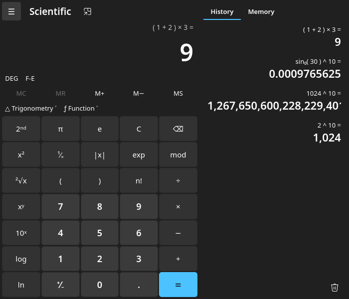

# calc-qt
calc-qt is a Linux port of the open source Windows Calculator. It is written in C++ and uses Qt 6 for its user interface.
The app provides standard, scientific, programmer, and date calculation functionality, built on the same calculation engine that ships with Windows Calculator.

calc-qt is an unofficial community project. It is not made, supported, or endorsed by Microsoft. For the official Windows Calculator, see the
[upstream repository](https://github.com/microsoft/calculator) and its original [README](README.upstream.md).



## Features
- Standard Calculator functionality which offers basic operations and evaluates commands immediately as they are entered.
- Scientific Calculator functionality which offers expanded operations and evaluates commands using order of operations.
- Programmer Calculator functionality which offers common mathematical operations for developers including conversion between common bases,
  word sizes from QWORD to BYTE, bitwise operators, four bit shift modes, and a bit toggling keypad.
- Date Calculation functionality which offers the difference between two dates, as well as the ability to add/subtract years, months and/or days to/from a given input date.
  calc-qt supports the Gregorian calendar.
- Calculation history and memory capabilities.
- [Infinite precision](https://en.wikipedia.org/wiki/Arbitrary-precision_arithmetic) for basic
  arithmetic operations (addition, subtraction, multiplication, division) so that calculations
  never lose precision.
- Light and dark themes that follow the desktop setting, and an option to keep the window on top.
- Engine messages, mode names and date strings in every language that Windows Calculator ships, with number and date formats that follow the system locale.

## How calc-qt relates to Windows Calculator
calc-qt keeps the upstream source tree intact and adds a Linux front end next to it:
- The calculation engine, [CalcManager](src/CalcManager), is built from the upstream sources without changes.
- The Windows user interface (UWP, XAML and C#) is replaced by a Qt 6 Widgets interface in [src/linux](src/linux).
  The view model logic for modes, radix, history and date calculation is ported to C++.
- Translations are read from the upstream resource files at build time.

The Linux sources, build files and tests live in [src/linux](src/linux). The Debian packaging lives in [debian](debian).
For a detailed description of the port, see the [Linux port README](src/linux/README.md).
For the architecture of the upstream app, see [ApplicationArchitecture.md](docs/ApplicationArchitecture.md).

## Getting started
Prerequisites:
- A Linux distribution with Qt 6.5 or newer. calc-qt is developed on Debian 13 (trixie).
- CMake 3.21 or newer, Ninja, a C++17 compiler, and Python 3.

  On Debian or Ubuntu:
    ```
    sudo apt install cmake ninja-build g++ python3 qt6-base-dev
    ```

- Get the code:
    ```
    git clone https://github.com/99ecarvalho/calc-qt.git
    ```

- Build and run calc-qt from the repository root:
    ```
    cmake -S src/linux -B build-linux -G Ninja
    cmake --build build-linux
    ./build-linux/calc-qt
    ```

- To run the tests:
    ```
    ctest --test-dir build-linux --output-on-failure
    ```

### Debian package
calc-qt can be built and installed as a Debian package. Package versions end in `+localN` so they never clash with a distribution package,
and they name the upstream commit the build is based on.

- Install the build dependencies from the repository root:
    ```
    sudo apt build-dep ./
    ```

- Build the package. The tests run as part of the build, and the packages are placed in `dist/`:
    ```
    src/linux/packaging/build-deb.sh
    ```

- Install the package:
    ```
    sudo apt install ./dist/calc-qt_*_amd64.deb
    ```

## Contributing
Want to contribute? Issues and pull requests for calc-qt are welcome on [GitHub](https://github.com/99ecarvalho/calc-qt/issues).

Changes to the Linux port belong in `src/linux` and `debian`. Please avoid changing upstream files, so that calc-qt can keep following upstream.
Fixes to the calculation engine itself are best contributed to the [upstream project](https://github.com/microsoft/calculator), following its
[contributing guidelines](CONTRIBUTING.md). calc-qt picks them up on the next rebase.

## Staying in sync with upstream
The `main` branch follows the upstream repository. The Linux port lives on the `linux-port` branch and is rebased onto upstream as it moves:
```
git remote add upstream https://github.com/microsoft/calculator.git
git fetch upstream
git rebase upstream/main
```
The port adds files rather than changing them. The one exception is this README: the upstream README is kept as
[README.upstream.md](README.upstream.md). If upstream changes its README, resolve the rebase by moving the new content into `README.upstream.md`.

## Roadmap
Planned work for calc-qt:
- Unit converter, built on the upstream converter engine and unit data.
- Currency converter, once a freely licensed source of exchange rates is chosen.

### Graphing Mode
Graphing is not available in calc-qt. Windows Calculator draws graphs with a proprietary Microsoft-built graphing engine that is not part of
the upstream repository, which only contains a [mock implementation of the engine](/src/GraphingImpl/Mocks). Graphing in calc-qt would need a new engine.

## Diagnostic Data
calc-qt does not collect or send usage data. The upstream diagnostic data component is not part of the Linux build, and calc-qt does not connect to the network.

## Currency Converter
calc-qt does not include a currency converter yet. The data that Microsoft uses for the currency converter feature in Windows Calculator is not
licensed for use by calc-qt, so a future currency converter will use a different data source.

## Reporting Security Issues
For security issues in the Linux port, please use [private vulnerability reporting](https://github.com/99ecarvalho/calc-qt/security/advisories/new) on GitHub.
For security issues in the upstream code, please refer to [SECURITY.md](./SECURITY.md).

## License
Copyright (c) Microsoft Corporation. All rights reserved.
The Linux port is copyright (c) 2026 Eduardo Correia.

Licensed under the [MIT License](./LICENSE).

The app icon uses the calculator glyph from [Tabler Icons](https://tabler.io/icons), licensed under the MIT License.
Microsoft and Windows are trademarks of Microsoft Corporation.
