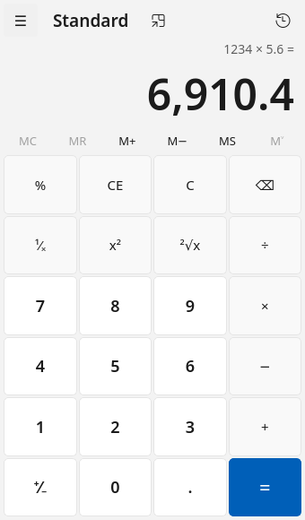
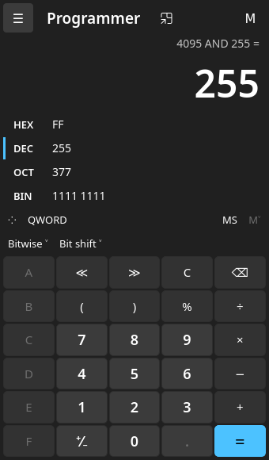

# calc-qt

This folder ports Windows Calculator to Linux, as `calc-qt`.

The math comes from the upstream engine, `src/CalcManager`. It is built as is. No upstream file is changed.
The Windows interface (UWP, XAML and C#) does not run on Linux. It is replaced by a Qt 6 Widgets interface in `app/`.

| Standard | Scientific, with history | Programmer |
|---|---|---|
|  |  |  |

## What works

- Standard, Scientific, Programmer and Date calculation modes.
- Arbitrary precision math from the original engine (Ratpack). So `0.1 + 0.2` gives `0.3`.
- Scientific: DEG, RAD and GRAD. F-E notation. 2nd functions. Trigonometry and Function flyouts.
- Programmer: HEX, DEC, OCT and BIN at once. QWORD to BYTE. Bitwise operators. Four bit shift modes. A bit toggling keypad.
- Date calculation: the difference between two dates, or a date plus or minus years, months and days. Gregorian calendar only. Same algorithm and range (1601 to 9999) as Windows.
- History. Click an entry to continue from it.
- Memory: MS, MR, M+, M−, MC, per item too.
- Copy and paste (Ctrl+C, Ctrl+V).
- Keyboard shortcuts close to the Windows app.
- Light and dark theme, following the system or set by hand.
- Keep on top.
- Engine messages, mode names and date strings in every language the upstream ships. Number separators and date formats follow your locale.

## What is not ported

- Unit and currency converters, graphing. They live in the C# view models and in Windows-only libraries. The graphing engine is not open source.
- Non-Gregorian calendars in date calculation.

## Build

You need CMake 3.21+, a C++17 compiler, Python 3 and Qt 6.5+.

On Debian or Ubuntu:

```bash
sudo apt install cmake ninja-build g++ python3 qt6-base-dev
```

Build from the repository root:

```bash
cmake -S src/linux -B build-linux -G Ninja
```

```bash
cmake --build build-linux
```

Run it:

```bash
./build-linux/calc-qt
```

Run the engine tests:

```bash
ctest --test-dir build-linux --output-on-failure
```

Install for your user (adds a menu entry):

```bash
cmake --install build-linux --prefix ~/.local
```

## Debian package

The packaging lives in `debian/` at the repository root.
Package versions end in `+localN`, so they never clash with a distribution package.
The version also names the upstream commit it is based on.

Install the build dependencies once, from the repository root:

```bash
sudo apt build-dep ./
```

Build the package. It runs the tests, then puts the `.deb` files in `dist/`:

```bash
src/linux/packaging/build-deb.sh
```

Install it:

```bash
sudo apt install ./dist/calc-qt_*_amd64.deb
```

For a new local build, add an entry to `debian/changelog` with `dch -l +local`, or edit the version by hand.

## Keeping up with upstream

The port only adds files: `src/linux/`, `debian/` and two lines in `.gitignore`.
No upstream file is changed, so rebasing onto a new upstream is usually conflict free.

```bash
git remote add upstream https://github.com/microsoft/calculator.git
```

```bash
git fetch upstream && git rebase upstream/main
```

Then rebuild and run the tests. If upstream adds or renames engine sources, the CMake globs pick them up.
If upstream renames a string key, `tools/extract-strings.py` stops the build and names the key.

## Keyboard

| Key | Action |
|---|---|
| 0-9, + - * / | Digits and operators |
| Enter or = | Equals |
| Esc / Delete / Backspace | C / CE / ⌫ |
| F9 | ± |
| % | Percent (Programmer: mod) |
| r, q, @ | 1/x, x², √x |
| Ctrl+M, R, P, Q, L | MS, MR, M+, M−, MC |
| Ctrl+H | History |
| Ctrl+Shift+D | Clear history |
| Alt+1, 2, 3, 4 | Standard, Scientific, Programmer, Date calculation |
| Scientific: s o t, S O T | sin cos tan, and their inverses |
| Scientific: ^ or y, #, !, n, l, p, e, x, v | xʸ, x³, n!, ln, log, π, e, exp, F-E |
| Scientific: F3, F4, F5 | DEG, RAD, GRAD |
| Programmer: A-F | Hex digits |
| Programmer: F5, F6, F7, F8 | HEX, DEC, OCT, BIN |
| Programmer: < > & \| ~ ^ | Shift, AND, OR, NOT, XOR |

## Layout

- `CMakeLists.txt`: builds CalcManager as a static library, the app and the tests.
- `compat/`: stand-ins for three Windows SDK headers, and a force-included header with standard includes MSVC adds implicitly.
- `app/CalcBridge`: implements the engine display callback (`ICalcDisplay`) and turns it into Qt signals. It ports the view model logic for modes, radix and history replay.
- `app/EngineResources`: reads `CEngineStrings.resw` from every locale, embedded as Qt resources.
- `app/MainWindow`: the interface.
- `app/DateCalculator`, `app/DatePage`: port of the upstream date engine and its view.
- `app/AppStrings`, `tools/extract-strings.py`: UI strings taken from the upstream `Resources.resw` at build time.
- `tests/`: headless checks of the calculation engine and the date engine.
- `packaging/`: desktop entry, manual page and `build-deb.sh`.

The app also takes `--type <keys>` and `--screenshot <file>`. They help with tests and docs.

## License

MIT, like the upstream project. See `LICENSE` at the repository root.

The app icon uses the "calculator" glyph from [Tabler Icons](https://tabler.io/icons), MIT License, Copyright (c) 2020-2024 Paweł Kuna. See `packaging/icons/LICENSE.tabler-icons`.

This is an unofficial port. It is not made or endorsed by Microsoft. "Microsoft" and "Windows" are trademarks of Microsoft Corporation.
